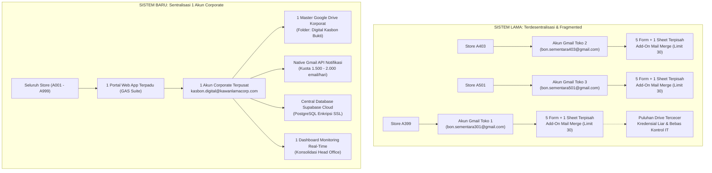

# MEMORANDUM INTERNAL & PROPOSAL FORMAL

**Nomor Dokumen:** 012/MEMO-IT-FIN/DKP/X/2026  
**Tanggal:** 23 Oktober 2026  
**Perihal:** Permohonan Pengadaan & Aktivasi 1 Akun Email Corporate Terpusat untuk Sentralisasi Operasional Sistem Digital Kasbon (Petty Cash Enterprise)  
**Lampiran:** 1 Berkas Dokumen Komparasi Before vs After & Arsitektur Solusi  

---

| Kepada | **Head of Corporate IT & Infrastructure**<br>**General Manager Finance & Accounting** |
| :--- | :--- |
| **Dari** | Tim Inisiatif Digitalisasi Kasbon (Petty Cash Modernization) |
| **Domain Korporasi** | `@kawanlamacorp.com` |
| **Sifat** | Penting & Segera (High Priority - Efficiency & Security) |

---

## 1. Latar Belakang & Urgensi

Berdasarkan tinjauan operasional pada sistem lama (*Bon Sementara Manual Spreadsheet*), proses peluncuran dan operasional kasbon di tingkat unit bisnis (toko/store) memiliki beban administrasi teknis yang sangat tinggi serta mengandung risiko keamanan data korporasi.

Pada sistem lama, setiap penambahan 1 toko baru mewajibkan tim untuk menjalankan **58 tahapan manual** (mencakup 203 langkah teknis individual), yang meliputi:
1. Pembuatan dan pengelolaan akun Gmail personal/alter per toko (`bon.sementaraXXX@gmail.com`).
2. Penginstalan add-on pihak ketiga berbayar/terbatas (*Mail Merge for Sheets*) dengan batasan kuota uji coba (maksimal 30 baris email).
3. Duplikasi manual 5 Google Form dan 1 Google Spreadsheet per toko.
4. Pengaturan manual hak akses, transfer kepemilikan file bolak-balik antara akun alter dan akun toko, serta pengaturan kunci rentang (*protected ranges*) satu per satu.
5. *Copy-paste* sintaks ekspresi reguler (*regex*) NIK dan daftar email Manager/Senior Cashier secara manual ke dalam pertanyaan Google Form.
6. Membuka akses folder bukti/lampiran ke publik (*"Siapa saja yang memiliki link dapat melihat"*).

Model lama ini bersifat **terdesentralisasi (terpecah-pecah)**, rentan kebocoran data (*data breach*), menghabiskan puluhan jam kerja teknisi hanya untuk *maintenance*, dan sangat sulit diaudit secara konsolidasi oleh Manajemen Pusat.

Oleh karena itu, diajukan permohonan pengadaan **1 (satu) Akun Google Workspace Corporate resmi** (misalnya: `kasbon.digital@kawanlamacorp.com`) yang berfungsi sebagai *Service/System Account* terpusat untuk menaungi seluruh ekosistem **Aplikasi Digital Kasbon Enterprise**.

---

## 2. Arsitektur Komparasi Alur Sistem



---

## 3. Matriks Komparasi Mendalam (Before vs After)

Berikut adalah rincian dampak perbandingan antara metode lama (email terpisah per store) dengan metode baru (Google Apps Script terpusat dengan 1 email corporate):

| Parameter Evaluasi | Sistem Lama (Email Terpisah per Store) | Sistem Baru (1 Email Corporate Terpusat) | Dampak & Keuntungan Korporasi |
| :--- | :--- | :--- | :--- |
| **Struktur & Jumlah Akun** | Menggunakan puluhan akun Gmail personal liar (`bon.sementaraXXX@gmail.com`) dan akun alter. | **Tepat 1 Akun Resmi Google Workspace** (contoh: `kasbon.digital@kawanlamacorp.com`). | **Sentralisasi Identitas:** Mencegah kepemilikan aset perusahaan di akun email gratisan personal. |
| **Waktu Pendaftaran Store Baru** | **2 hingga 3 Jam per Store:** Wajib mengeksekusi 58 halaman (203 langkah konfigurasi manual). | **Hanya 10 Detik:** Cukup input Kode Store & Nama Store melalui Portal Admin. | **Efisiensi Waktu 99.8%:** Tidak ada lagi proses kloning form/sheet yang melelahkan. |
| **Ketergantungan Add-On Pihak Ketiga** | Bergantung pada ekstensi pihak ketiga (*Mail Merge for Sheets*) yang memiliki limit gratis 30 baris/akun dan risiko biaya langganan tambahan. | **100% Native Google Apps Script (`GmailApp` / `MailApp`):** Dibangun mandiri tanpa add-on pihak ketiga. | **Zero Recurring Tool Cost:** Tidak ada risiko sistem macet akibat kuota trial habis. |
| **Biaya Operasional (Cost Impact)** | Potensi biaya langganan add-on mail merge per toko ($9.99/bulan x puluhan toko) atau risiko terhenti saat limit. | **Rp 0,- tambahan biaya software:** Hanya memanfaatkan 1 lisensi Google Workspace yang sudah ada di perusahaan. | **Penghematan Finansial Signifikan:** Mengeliminasi pengeluaran lisensi ekstensi eksternal. |
| **Kapasitas & Kuota Email Notifikasi** | Terbatas pada kuota Gmail gratis (~100 email/hari) dan sering gagal terkirim jika transaksi toko padat. | **1.500 s/d 2.000 email/hari** sesuai kuota resmi Google Workspace Enterprise. | **Reliabilitas Tinggi:** Seluruh notifikasi persetujuan Manager & Kasir terkirim seketika tanpa terhambat kuota. |
| **Penyimpanan File Bukti (Google Drive)** | Puluhan folder tersebar di Google Drive akun pribadi masing-masing toko, rawan hilang saat pergantian PIC toko. | **1 Master Google Drive Folder:** Folder terstruktur rapi (`Digital Kasbon Bukti / YYYY-MM / No_Pengajuan`). | **Aset Terkonsolidasi:** Seluruh bukti nota & pencairan tersimpan di bawah kendali IT Head Office. |
| **Keamanan & Kepatuhan Data (Governance)** | File spreadsheet disetel ke publik (*"Siapa saja yang memiliki link dapat melihat"*), sangat rentan kebocoran data keuangan ke pihak luar. | **Strict Enterprise RBAC:** Akses terkunci aman di lingkungan domain internal `@kawanlamacorp.com` dan basis data terenkripsi. | **Kepatuhan Audit & ISO:** Melindungi kerahasiaan arus kas petty cash perusahaan dari akses publik tanpa otorisasi. |
| **Otorisasi & Login Pengguna** | Tidak ada verifikasi email resmi. Pengguna mengisi dropdown nama secara manual tanpa validasi identitas. | **Auto-Detect SSO Google:** Otomatis membaca email resmi pemohon yang sedang login dan dikunci permanen (*readonly*). | **Akuntabilitas Mutlak:** Tidak ada pemalsuan identitas pemohon; transaksi terkunci ke akun Google aktif. |
| **Pencegahan Fraud (Anti-Double Kasbon)** | Mengandalkan ketelitian mata kasir membaca baris spreadsheet manual; sering lolos kasbon ganda. | **Algoritma Validasi Ganda Otomatis:** Sistem langsung menolak pengajuan baru jika email atau NIP masih memiliki kasbon berjalan. | **Mitigasi Risiko Keuangan:** Menjamin *zero double kasbon* sebelum pertanggungjawaban kasbon lama diselesaikan. |
| **Pemeliharaan Master Data (PIC & NIP)** | Setiap ada rotasi Manager/Kasir, admin harus membuka satu per satu form toko untuk mengganti opsi dropdown dan regex NIP. | **Update 1 Pintu di Portal Admin:** Perubahan data PIC store otomatis berlaku seketika ke seluruh antarmuka aplikasi. | **Beban Kerja Admin Turun Drastis:** Bebas dari keharusan merawat ratusan form Google. |
| **Monitoring & Rekonsiliasi Finance** | Finance HO harus meminta dan mengumpulkan puluhan link spreadsheet berbeda tiap akhir bulan. | **1 Layar Dashboard Monitoring Real-Time:** Menampilkan statistik realisasi, status kasbon aktif, dan opsi unduh rekap Excel/PDF. | **Percepatan Tutup Buku:** Rekonsiliasi kas kecil toko dapat diselesaikan dalam hitungan menit. |

---

## 4. Fungsi & Tanggung Jawab Akun Corporate yang Diajukan

Akun corporate yang dimohonkan (`kasbon.digital@kawanlamacorp.com`) akan dikonfigurasikan khusus sebagai **Akun Sistem (Non-Personal)** dengan tugas operasional sebagai berikut:

```
+-----------------------------------------------------------------------------------+
|               PERAN 1 AKUN CORPORATE SISTEM DIGITAL KASBON                        |
+-----------------------------------------------------------------------------------+
| 1. Script Host & Web App Deployer                                                 |
|    - Menyimpan dan mengeksekusi 6 modular Google Apps Script (Dashboard,          |
|      Form Pengajuan, Portal Manager, Portal Cashier, Portal Requester, Admin).    |
|                                                                                   |
| 2. Centralized Cloud File Repository                                              |
|    - Memiliki dan mengelola master root folder Google Drive:                      |
|      "Digital Kasbon Bukti" dengan pengaturan kuota pintar otomatis (< 1 GB).     |
|                                                                                   |
| 3. Automated Notification Dispatcher                                              |
|    - Mengirim email notifikasi resmi atas nama sistem perusahaan ke:              |
|      * Manager Incharge (permintaan approval kasbon baru & validasi realisasi)    |
|      * Senior Cashier (notifikasi pencairan uang & verifikasi nota struk)         |
|      * Pemohon / Karyawan (konfirmasi transfer dana & tanda terima digital)       |
|                                                                                   |
| 4. Security & Audit Logging Guardian                                              |
|    - Menjaga integritas interaksi API antara Google Workspace dan Supabase Cloud. |
+-----------------------------------------------------------------------------------+
```

---

## 5. Rincian Kebutuhan Teknis Akun Corporate

Untuk merealisasikan arsitektur ini, berikut parameter akun yang diperlukan dari Divisi IT:

1. **Nama Akun / Alamat Email:**  
   `kasbon.digital@kawanlamacorp.com`  
   *(atau alternatif nama sesuai standar penamaan sistem korporasi: `digital.kasbon@kawanlamacorp.com` / `pettycash.system@kawanlamacorp.com`)*
2. **Display Name (Nama Pengirim):**  
   `Digital Kasbon System - Kawan Lama Group`
3. **Tipe Lisensi:**  
   Google Workspace Standard / Business (Cukup 1 user/seat yang memiliki akses ke Google Drive, Gmail, dan Google Apps Script).
4. **Kebijakan Akses (IT Admin Policy):**  
   - Diizinkan untuk mempublikasikan Web App Google Apps Script dengan akses bagi pengguna internal organisasi (`Within Domain`).
   - Tidak memerlukan hak akses Super Admin Google Workspace (cukup *standard user*).

---

## 6. Rencana Migrasi & Cut-Over

Setelah akun corporate tersebut diaktifkan oleh IT:
1. **Hari 1:** Pendelegasian Script & Deployment ID ke akun corporate baru melalui *clasp* atau Git repository resmi.
2. **Hari 2:** Pembuatan folder root Google Drive terpusat di akun baru dan pengujian notifikasi email end-to-end.
3. **Hari 3:** Sosialisasi link portal terpadu ke seluruh Manager dan Senior Cashier toko.
4. **Hari 4:** Menonaktifkan (*decommission*) seluruh spreadsheet lama dan akun-akun Gmail alter per toko, sehingga seluruh tata kelola kasbon resmi 100% tersentralisasi di bawah akun corporate.

---

## 7. Kesimpulan & Rekomendasi

Peralihan dari sistem lama berbasis puluhan email toko ke **1 Akun Corporate Terpusat** bukan hanya sekadar pembaruan aplikasi, melainkan langkah krusial untuk:
- Mengamankan aset data keuangan perusahaan di bawah naungan domain resmi `@kawanlamacorp.com`.
- Menghapus 58 langkah manual konfigurasi yang membuang waktu dan berisiko tinggi.
- Menjamin kelancaran operasional ribuan transaksi kasbon toko tanpa kendala limit software pihak ketiga.

Kami memohon dukungan dan persetujuan dari Bapak/Ibu Manajemen serta Divisi IT untuk pengadaan akun corporate tersebut.

---

### Lembar Persetujuan

| Diajukan Oleh: | Disetujui Oleh (IT): | Disetujui Oleh (Finance): |
| :---: | :---: | :---: |
| <br><br>____________________<br>**Achmad Fajar Setiawan**<br>Project Leader Digital Kasbon | <br><br>____________________<br>**Head of Corporate IT**<br>Kawan Lama Group | <br><br>____________________<br>**GM Finance & Accounting**<br>Kawan Lama Group |
